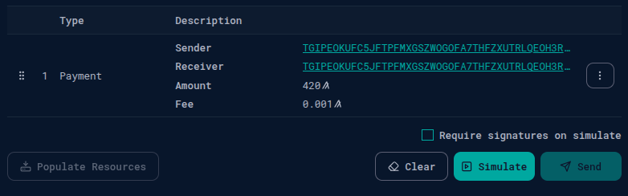
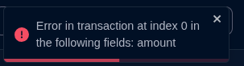

# Transaction Wizard URL Parameters

A written walkthrough of payment-form prefilling through URL parameters in AlgoKit Lora's Transaction Wizard.

The repository contains the challenge documentation and supporting images. The implementation belongs to the referenced Lora work; this repository is the explanation and submission artifact.

## Existing project notes

The original guide below preserves project-specific context, credits, examples, and historical setup details. Referenced providers, branches, and deployments may have changed since it was written.

<details>
<summary>Read the original project documentation</summary>

# 💸 Transaction Wizard – Payment via URL Parameters

This update adds support for creating **payment transactions** in the Transaction Wizard directly from URL query parameters.

It enables developers and users to generate deep links that prefill payment transaction forms without manual input, streamlining workflows for automation, testing, and sharing.

---

## ✨ New Feature

> **Support for pre-filling payment transactions using URL parameters**

You can now deep link into the Transaction Wizard with a valid payment transaction defined via query parameters.

---

## ⚙️ Setup

```bash
# Install dependencies
npm install

# Create a .env file and configure it using .env.sample

# Run Algorand localnet with docker and algokit
algokit localnet init

# Run the development server
npm run dev

# Run payment URL search params tests
npm run test -- transactions-url-search-params
```

## 🔗 Example URL

http://localhost:1420/localnet/transaction-wizard?type[0]=pay&sender[0]=TGIPEOKUFC5JFTPFMXGSZWOGOFA7THFZXUTRLQEOH3RD3LGI6QEEWJNML4&fee[0]=1000&receiver[0]=TGIPEOKUFC5JFTPFMXGSZWOGOFA7THFZXUTRLQEOH3RD3LGI6QEEWJNML4&amount[0]=1

## 📘 Documentation

## ✅ Supported Query Parameters

| Parameter             | Description                           | Required |
| --------------------- | ------------------------------------- | -------- |
| `type[0]`             | Must be `"pay"`                       | ✅       |
| `sender[0]`           | Algorand sender address               | ✅       |
| `receiver[0]`         | Algorand receiver address             | ✅       |
| `amount[0]`           | Transfer amount in microAlgos         | ✅       |
| `fee[0]`              | Optional transaction fee (microAlgos) | ❌       |
| `validRound[0]`       | Optional first valid round            | ❌       |
| `note[0]`             | Optional free-form note               | ❌       |
| `closeRemainderTo[0]` | Optional close-to address             | ❌       |

## 🌐 Example URLs

Minimal valid transaction:

http://localhost:1420/localnet/transaction-wizard?type[0]=pay&sender[0]=ADDR1&receiver[0]=ADDR2&amount[0]=1000000

With optional fields:

http://localhost:1420/localnet/transaction-wizard?type[0]=pay&sender[0]=ADDR1&receiver[0]=ADDR2&amount[0]=1000000&fee[0]=1000&validRound[0]=2000


## ⚠️ Error Scenarios

| Scenario                       | Error Message                                                                                         |
| ------------------------------ | ----------------------------------------------------------------------------------------------------- |
| Missing required `sender`      | Error in transaction at index 0 in the following fields: `sender-value`, `sender-resolvedAddress`     |
| Missing required `receiver`    | Error in transaction at index 0 in the following fields: `receiver-value`, `receiver-resolvedAddress` |
| `amount = 0`                   | Error in transaction at index 0 in the following fields: `amount`                                     |
| Malformed Algorand address     | Field-specific error related to `-value` and `-resolvedAddress`                                       |
| Missing or incorrect `type[0]` | Transaction is ignored; fallback to "No transactions."                                                |
| Invalid parameter structure    | Transaction skipped or safely ignored                                                                 |



## ✅ Tests

```ts
// Unit Test
import { transformPaymentTransaction } from "@/utils/transactionTransformer";

it("Parses valid payment parameters", () => {
  const params = {
    type: "pay",
    sender: "ADDR1",
    receiver: "ADDR2",
    amount: "1",
    fee: "1000",
    validRound: "1000",
  };

  const result = transformPaymentTransaction(params);

  expect(result).toEqual({
    type: "pay",
    sender: { value: "ADDR1" },
    receiver: { value: "ADDR2" },
    amount: { value: 1 },
    fee: { value: 1000 },
    validRound: { value: 1000 },
  });
});

// Integration Test
it("should render sender and receiver from URL", () => {
  const sender = "TGIPEOKUFC5JFTPF...";
  const receiver = "AENCK6AVVGCOQM6XG...";

  renderTxnsWizardPageWithSearchParams({
    searchParams: new URLSearchParams({
      "type[0]": "pay",
      "sender[0]": sender,
      "receiver[0]": receiver,
      "amount[0]": "1",
      "fee[0]": "1000",
      "validRound[0]": "1000",
    }),
  });

  expect(screen.getByText(sender)).toBeInTheDocument();
  expect(screen.getByText(receiver)).toBeInTheDocument();
});
```

## 🛠 Developer Notes

Parsing logic lives in utils/transactionTransformer.ts

The wizard uses URLSearchParams for param extraction

Errors appear in a toast and point to failing fields

Applies only to pay transactions (keyreg already supported)

## 📝 Changelog

add support for parsing payment transactions from URL params (#wizard-pay) (917c943)

add zod schema for payment validation (#wizard-pay) (be51659)

add unit & integration tests for payment params (#wizard-pay) (8ebd247)

improve error handling for malformed receiver and amount = 0 cases (#wizard-pay) (69c75b7)

update README with parameter docs, examples, and error messages (#wizard-pay) (9e5004e)

refactor transformer to improve data types for URL param usage (#wizard-pay) (4918bf5)

update .env to use sample config for local dev (#wizard-pay) (662ecbf)

</details>
